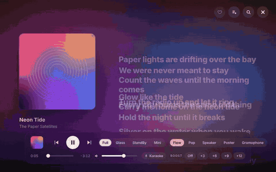
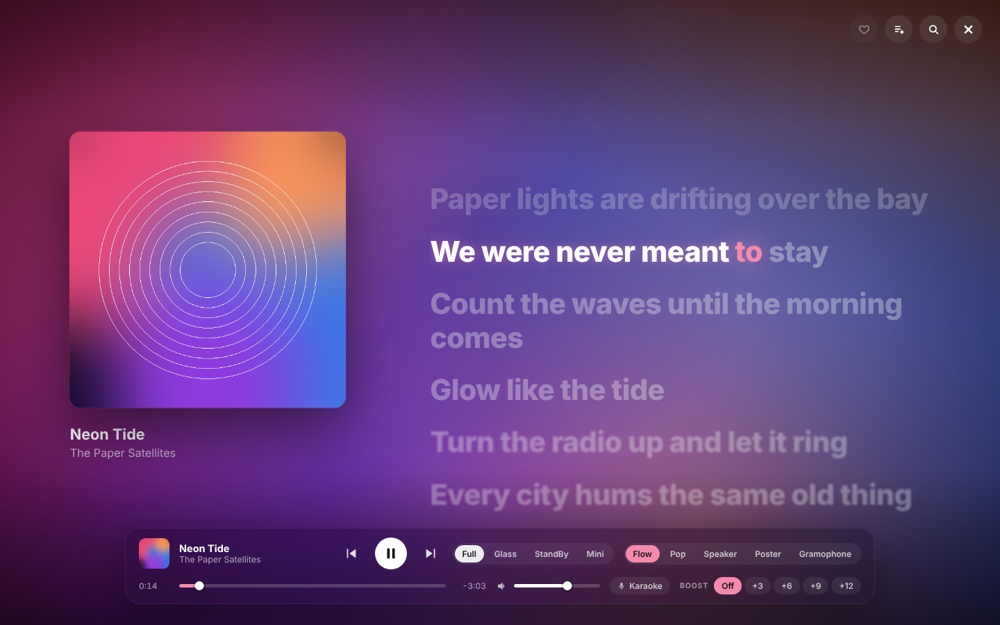
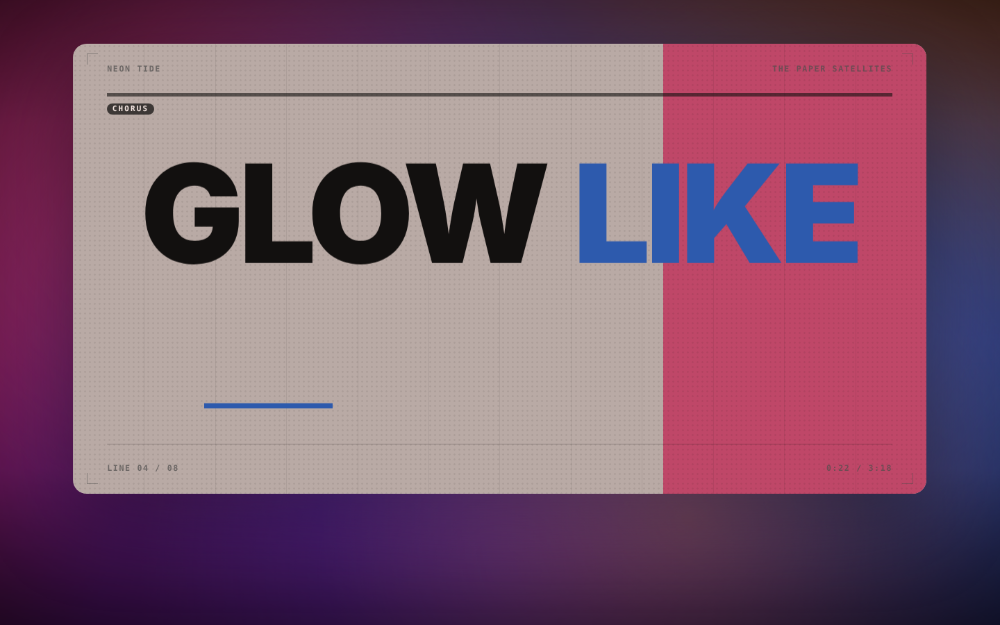
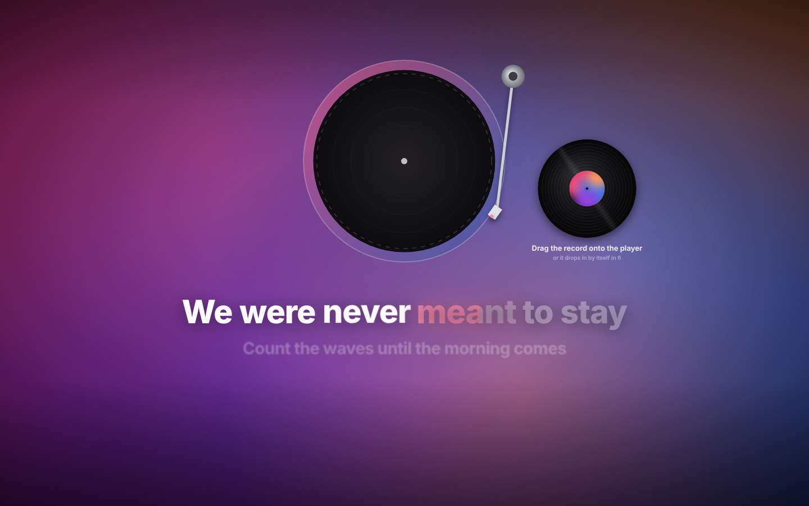
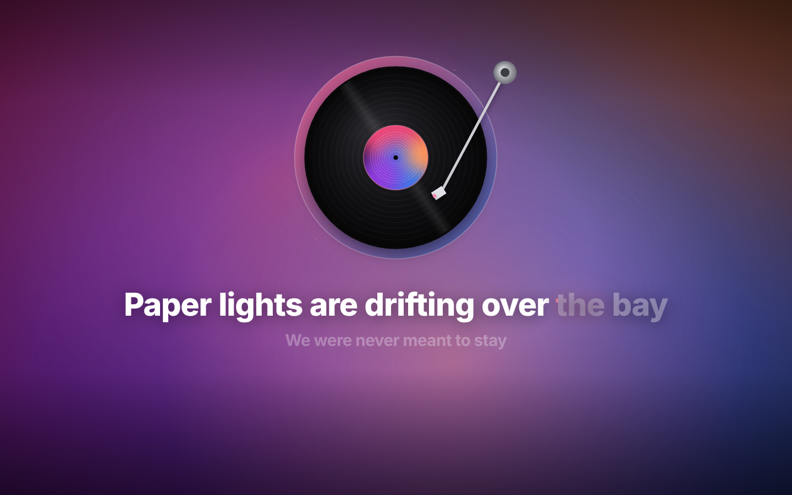
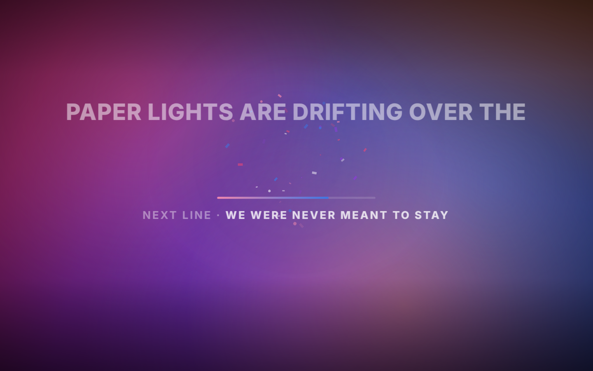
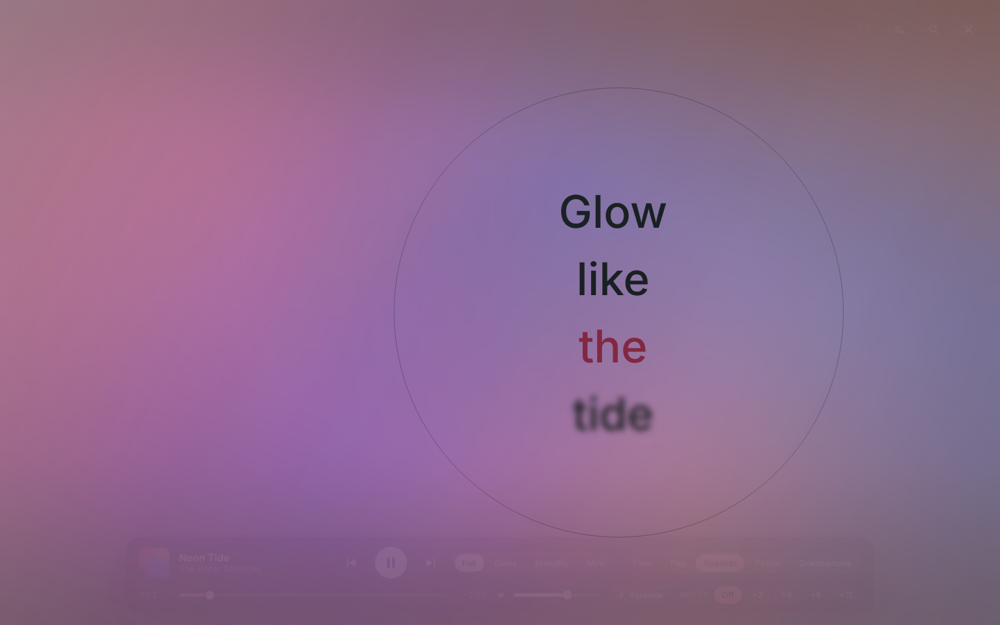
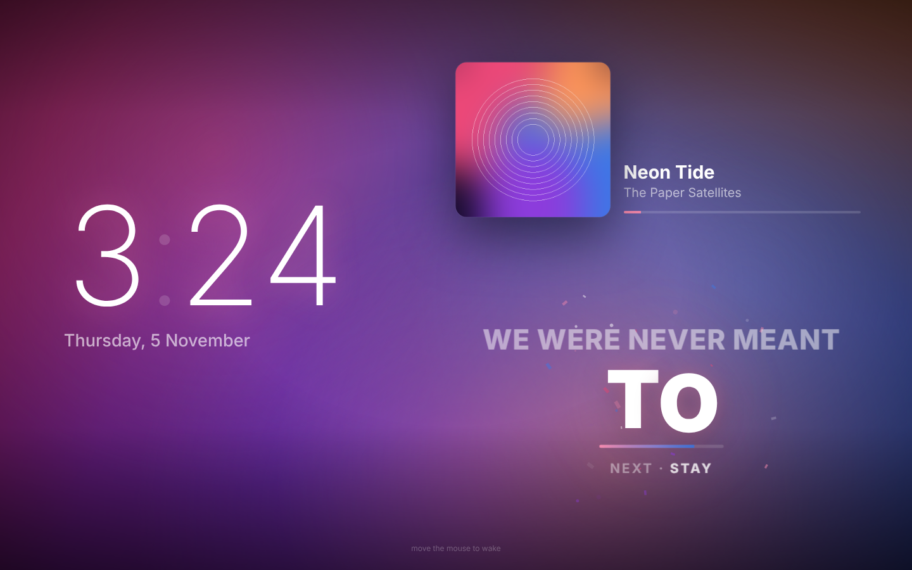
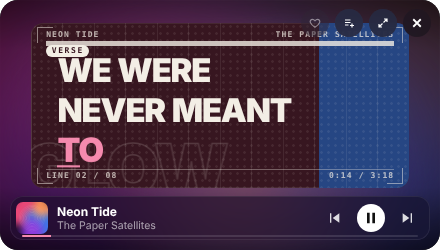

# Glowlyrics

**Ambient screen-edge glow and synced, animated lyrics for Apple Music on your Mac.**

Your screen's edges glow in the album's colors and pulse with the beat, while the lyrics play word by word, karaoke style.
Free for personal use.

[Install](#install) · [Features](#features) · [Shortcuts](#shortcuts) · [FAQ](#faq-and-troubleshooting) · [Releases](https://github.com/imayanjain/glowlyrics/releases)

| | |
|---|---|
|  |  |
|  |  |
|  |  |
|  |  |

*Screenshots and demo use a made-up track and made-up lyrics.*

## Features

**Edge glow**
- A soft rim light around every connected display. It runs as one continuous gradient across a laptop and an external monitor.
- Four animations: Static, Breathe, Flow (the gradient drifts around the rim) and Chase (light runs along the edges).
- Colors come from the current album art, a preset, or two custom colors.
- Music Sync: the glow pulses on kicks, using live audio analysis.

**Lyrics**
- Synced lyrics from [lrclib.net](https://lrclib.net), timed word by word. Glowlyrics uses the word timestamps when lrclib has them and estimates them from syllables when it doesn't.
- A floating lyrics bar showing the artwork, the current line, the next line and progress.
- Speaker-delay correction for Bluetooth speakers, plus per-song timing nudges that are remembered.

**Immersive mode** (⌘⌥L)
- Five lyric styles (keys `1`–`5`):
  - **Flow**: scrolling lines with a gradient sweep
  - **Pop**: one word at a time, and each word enters by what it is: short words punch in, line endings drop, held notes stretch for as long as they're sung, and stressed words burst with confetti. The next word waits underneath so a room can sing along.
  - **Speaker**: kinetic typography on a frosted sheet that fills the whole screen
  - **Poster**: every line is printed as its own poster, with type fitted to the page, colour fields, a grid and the track credits. Verses print dark, the chorus prints on paper, and instrumentals get their own sheet showing the next line.
  - **Gramophone**: every song starts with the setup. The player is empty, the arm is parked and the song's record waits beside it: drag it onto the player (or click it), the arm swings over and the needle drops. Then it comes alive: the record breathes with the bass, kicks send shockwaves, the grooves ripple with the mids, highs throw sparks and the singer's voice lights the label. If nobody drags it, the record drops in by itself after a few seconds.
- Three views:
  - **Full**: fills the screen
  - **Glass**: see-through, so you can still see your windows behind it
  - **StandBy**: a large clock with now playing, which turns on automatically after a few idle minutes
- **Mini player** (⌘⌥M): immersive slides down into a small floating window that stays on top while you work, which is handy if you only have one screen. Drag it anywhere (it snaps to the edges), and double-click it or press ⌘⌥M to slide back to full screen. When you step away it opens StandBy, then slides back to Mini when you return.
- Seek bar, previous/play/next, volume and boost. The controls hide when you're idle and come back when you move the mouse or scroll.
- Search your library or the whole Apple Music catalog, and pick a song to play it right away without leaving the view.
- **Up Next queue**: press ＋ (or Shift+Enter) on any search result to queue it. Queued songs play in order when the current song ends, and Next jumps straight to them. Open search to see, reorder by playing, or remove what's queued.
- **Favourite** the song that's playing with the ♡ button (or `F`, or ⌘⌥F from anywhere). It's the same Favourite you see in Music.
- **Add to playlist** with the playlist button (or `P`): pick one of your playlists, search them, or type a name to make a new one. Apple Music songs you're streaming are added to your library first, the same way Music does it.
- The animations follow the music itself: Glowlyrics splits the sound into bass, mids, highs and voice, and times them to your speaker.
- It doesn't take keyboard focus, so typing in other apps never pauses your music.

**Sound**
- Speaker fallback: if your Bluetooth speaker disconnects while a Multi-Output Device is selected (where macOS would leave you with silence), Glowlyrics switches to the MacBook speakers and mic, then back to your setup when the speaker reconnects.
- Pause for voice and calls: when Siri, a voice assistant, dictation or a call starts using the mic, the music pauses. When the mic closes, it picks up where it left off.
- A volume booster (+3, +6, +9 or +12 dB) for everything your Mac plays, with a limiter so loud parts don't clip.
- **Karaoke** (the mic chip in immersive, `K`, or ⌘⌥K): turns the singer down live so you can sing over the song. Choose **Light** (the singer stays as a quiet guide), **Medium** or **Strong**. Only the voice's range is touched, and the level is given back so the band stays loud. It works best on songs where the lead vocal is in the middle of the mix; reverb and backing vocals stay. Needs BlackHole, like Boost.

**Settings** (⌘⌥P)
- One panel for all of the above.

## Requirements

- macOS 12 or later, on an Apple Silicon or Intel Mac. Built and tested on an Intel MacBook Pro.
- Apple Music, the Music app. Playing catalog songs needs an Apple Music subscription.
- [Homebrew](https://brew.sh)
- Python 3. Glowlyrics uses whichever install already has its packages: Homebrew, python.org or the system `/usr/bin/python3`.
- Optional: an external display, a Bluetooth speaker and BlackHole (for beat sync, the music-reactive animations, Boost and Karaoke). Everything else works without them.

## Install

1. Download **[Glowlyrics.zip](https://github.com/imayanjain/glowlyrics/releases/latest/download/Glowlyrics.zip)** from the [latest release](https://github.com/imayanjain/glowlyrics/releases/latest) and unzip it.
2. Move the **Glowlyrics** folder somewhere it can stay, for example your home folder.
3. Open Terminal, type `bash ` (with a space), drag `install.sh` from the folder into the Terminal window, and press Return.

The installer sets up Hammerspoon, BlackHole and the Python packages Glowlyrics needs, adds it to your Hammerspoon config, and starts it. When Hammerspoon asks, allow **Accessibility** and allow it to control **Music**. In Hammerspoon's preferences, tick **Launch Hammerspoon at login** so Glowlyrics starts with your Mac.

**For beat sync and the volume booster (optional)**

1. Open **Audio MIDI Setup**, click **+** and choose **Create Multi-Output Device**.
2. Tick your speakers or headphones and **BlackHole 2ch**.
3. Set your speakers as the primary device, and turn on **Drift Correction** for BlackHole.
4. In **System Settings → Sound → Output**, choose **Multi-Output Device**.

If BlackHole was just installed, restart your Mac once first. Without these steps the glow and lyrics still work, but the glow won't pulse with the beat and Boost stays off.

**Updating:** download the new release, replace your Glowlyrics folder with it, and run the installer again. Your settings are kept.

## Shortcuts

| Keys | Action |
|---|---|
| ⌘⌥L | Open or close immersive mode |
| ⌘⌥M | Mini player: open it, or slide between Mini and full screen |
| ⌘⌥P | Settings |
| ⌘⌥F | Favourite the song that's playing |
| ⌘⌥K | Karaoke on / off |
| ⌘⌥[  /  ⌘⌥] | Lyrics earlier / later (saved per song) |
| ⌘⌥↑  /  ⌘⌥↓ | Volume |

Inside immersive mode (click it first): Space play/pause, ← → seek, ↑ ↓ volume, `1`–`5` style (Flow, Pop, Speaker, Poster, Gramophone), `V` view, `/` search, `F` favourite, `P` add to playlist, `K` karaoke, Esc close.

In search: Enter plays now, Shift+Enter adds to Up Next, ↑ ↓ move through results.

## Logs

Logs go to `hammerspoon.log` and `engine.log` in your Glowlyrics folder (menu bar ✦ → Open Logs Folder). Runtime state lives in `~/.local/share/glowlyrics/`.

## FAQ and troubleshooting

**Nothing shows up.** Click the ✦ icon in the menu bar. If it says "Engine: starting…" for long, choose *Open Logs Folder* and look at `engine.log`. The usual cause is missing Python packages: run the installer again, then choose *Restart Engine*.

**The lyrics say "No synced lyrics for this song".** lrclib.net doesn't have timed lyrics for that track yet. You can add them on [lrclib.net](https://lrclib.net) and everyone benefits. If the site itself is down, Glowlyrics keeps retrying while the song plays.

**The lyrics are a little early or late.** Press ⌘⌥[ or ⌘⌥] while the song plays. The correction is saved for that song. Bluetooth speakers are corrected automatically ("Speaker delay correction" in Settings).

**The glow doesn't pulse with the beat.** Beat sync needs BlackHole and a Multi-Output Device (step 4 of the setup). Without them the glow still follows the album colors.

**Boost or Karaoke says it needs BlackHole.** Same fix: install BlackHole and restart your Mac once.

**The animations look flat (the Gramophone record doesn't move, Pop doesn't shake).** They react to the sound going through BlackHole. Choose **Multi-Output Device** as your Sound output, or turn on Karaoke or Boost, which route the sound through it for you.

**Karaoke still lets me hear the singer.** Try **Strong**. Glowlyrics removes what sits in the centre of the mix in the voice's range, live, without an AI model, so reverb, backing vocals and voices recorded in stereo stay audible. If the song sounds thin, go back to **Light**.

**Add to playlist says it couldn't add the song.** The reason is in `hammerspoon.log`. Streaming songs are added to your library first; if your library doesn't sync (Sync Library is off in Music's settings), Music can't do that.

**Does it work with Spotify?** Not yet. It works with Apple Music. If you'd like Spotify support, say so in [Discussions](https://github.com/imayanjain/glowlyrics/discussions).

**Does it work with one screen?** Yes. Use the Mini player (⌘⌥M) to keep the lyrics in a small floating window while you work.

**Will typing pause my music?** No. Immersive mode never takes your keyboard unless you click it.

## Privacy

Glowlyrics runs entirely on your Mac, including Karaoke and the music analysis behind the animations. It sends the song title and artist to lrclib.net to fetch lyrics, and your search text to Apple's iTunes Search API when you search the catalog. Nothing else leaves your Mac, and there's no tracking or analytics.

## Uninstall

1. Remove the Glowlyrics lines from `~/.hammerspoon/init.lua` and reload Hammerspoon.
2. Delete the Glowlyrics folder and `~/.local/share/glowlyrics`.
3. Optional: `brew uninstall --cask hammerspoon blackhole-2ch`, and switch your Sound output back from "Multi-Output Device".

## Feedback

Found a bug or have an idea? Open an [issue](https://github.com/imayanjain/glowlyrics/issues) or start a [discussion](https://github.com/imayanjain/glowlyrics/discussions).

If Glowlyrics makes your desk look better, a ⭐ helps other people find it.

## Notes

- Apple doesn't let other apps start a catalog song directly. When you pick one in search, Glowlyrics opens the song's album in Music behind the immersive view, finds the song's row and sends Music a double-click on it, checks that it really is playing, then hides Music again. If Music ignores that, immersive steps aside for a split second to click it normally. If even that fails, the song is left open in Music.
- Music's own Up Next can't be controlled by other apps, so Glowlyrics keeps its own queue.
- ⌘⌥M replaces macOS's rarely used "minimize all windows" shortcut while Glowlyrics runs.
- Lyrics come from the community database at lrclib.net, so some songs won't have them. Glowlyrics doesn't bundle any lyrics.
- The idea of an edge glow plus a lyrics display was inspired by apps such as Lumn and Verci. Glowlyrics is an independent, from-scratch project and isn't affiliated with either one.
- Built by Ayan Jain with the help of Claude.

## License

Glowlyrics is free to download and use for personal, non-commercial purposes. The code, design and assets are © 2026 Ayan Jain, all rights reserved: copying, modifying, reusing or redistributing them isn't permitted without written permission. See [LICENSE](LICENSE) for the full terms.
